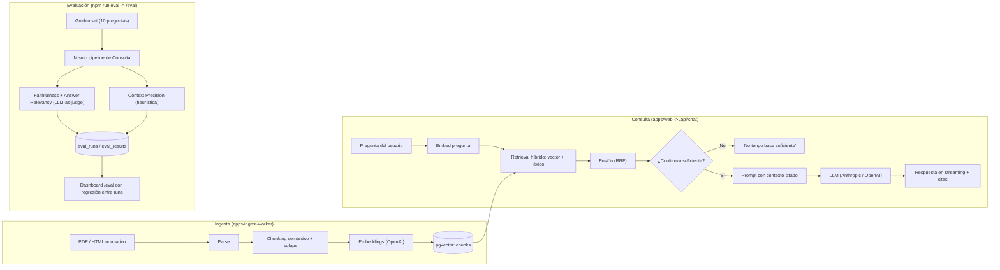

# ClauseLens

> Asistente RAG de consulta normativa, de nivel producción. Pregunta en lenguaje natural sobre
> un corpus regulatorio (GDPR, EU AI Act) y recibe respuestas ancladas a las cláusulas exactas
> que las sustentan — con un panel de evaluación que demuestra, con métricas, que no alucina.


**Demo:** pendiente de despliegue (Vercel + Neon + Railway). Mientras tanto, el
[quickstart](#quickstart) de abajo lo levanta en local en 5 comandos.

## El problema

La mayoría de demos de RAG hacen dos cosas mal: citan de forma imprecisa (o no citan en
absoluto) y no tienen ninguna disciplina de evaluación — "funciona cuando lo pruebo yo" no es
una garantía. En un dominio normativo eso es especialmente grave: una respuesta que suena
convincente pero no está anclada al artículo exacto, o que inventa una cláusula que no existe,
es peor que no responder.

ClauseLens está construido para que ambas cosas sean verificables, no solo afirmadas:

- **Cada afirmación cita su fragmento fuente** (documento, artículo, página) y la cita es
  clicable — abre el fragmento exacto, no solo "confía en mí".
- **Si el retrieval no encuentra base suficiente, el sistema lo dice explícitamente** en vez de
  rellenar el hueco con una respuesta plausible pero inventada.
- **Cada cambio se puede medir**: un golden set con preguntas de respuesta conocida (incluyendo
  preguntas deliberadamente fuera de corpus) corre contra el pipeline real y calcula
  faithfulness, answer relevancy y context precision — con los resultados guardados y
  comparables entre ejecuciones, no solo en la terminal de quien lo corrió.

## Arquitectura



Decisiones clave (por qué híbrido y no solo vectorial, por qué RRF, por qué el umbral 0.35, por
qué estas tres métricas, qué se dejó fuera de alcance) están documentadas con su razonamiento en
**[DECISIONS.md](./DECISIONS.md)**.

## Stack

- **Frontend / API:** Next.js 15 (App Router), TypeScript estricto, Tailwind + shadcn/ui,
  streaming con el Vercel AI SDK. Target de despliegue: Vercel.
- **Worker de ingesta:** Node + Hono. Target de despliegue: Railway.
- **Base de datos:** Postgres + pgvector (target Neon), Drizzle ORM — vector search, búsqueda de
  texto completo y datos relacionales en la misma base.
- **LLM:** capa de proveedor intercambiable (Anthropic / OpenAI por variable de entorno).
  Embeddings fijos a OpenAI (`text-embedding-3-large`, 3072 dim) — Anthropic no ofrece API de
  embeddings.

## Quickstart

```bash
cp .env.example .env                          # rellena ANTHROPIC_API_KEY y/o OPENAI_API_KEY
npm install
npm run docker:up && npm run db:migrate        # Postgres+pgvector local, schema aplicado
npm run db:seed                                # ingiere el corpus semilla (GDPR + EU AI Act)
npm run dev:web                                # http://localhost:3000
```

En otra terminal, para el worker de ingesta (`GET /healthz`, `POST /api/ingest`):
`npm run dev:worker` — expone `http://localhost:8787`.

Para correr el harness de evaluación una vez sembrado el corpus: `npm run eval`, resultados
visibles en `http://localhost:3000/eval`.

## Estructura del monorepo

```
apps/
  web/             Next.js — frontend de chat, /api/chat (streaming), /api/documents, /eval
  ingest-worker/   Hono — pipeline de ingesta; scripts de seed y de eval
    corpus/        Corpus semilla: GDPR (HTML) y EU AI Act (PDF), extractos reales de EUR-Lex
packages/
  db/              Schema Drizzle (documents, chunks, conversations, messages, eval_runs,
                   eval_results) + cliente Postgres, compartido por el resto de paquetes
  core/            Retrieval híbrido (RRF), umbral de confianza, proveedor LLM intercambiable,
                   construcción de prompt, harness de eval — compartido por web e ingest-worker
docker-compose.yml Postgres + pgvector para desarrollo local
```

## Scripts del monorepo

| Script | Qué hace |
| --- | --- |
| `npm run build` | build de `db` → `core` → `ingest-worker` → `web`, en ese orden |
| `npm run typecheck` | `tsc --noEmit` en cada workspace |
| `npm run lint` | ESLint (typescript-eslint `strictTypeChecked`) en cada workspace |
| `npm run test` | tests unitarios + integración (Vitest) |
| `npm run db:generate` | genera una migración Drizzle a partir de `packages/db/src/schema.ts` |
| `npm run db:migrate` | aplica las migraciones pendientes |
| `npm run db:studio` | abre Drizzle Studio |
| `npm run db:seed` | parsea, chunkea, embebe e inserta el corpus semilla |
| `npm run eval` | corre el golden set completo, guarda scores en `eval_runs`/`eval_results` |

## Tests

- **Unitarios (puros, sin red ni DB):** chunking (incluye el corte duro por tokens cuando una
  frase supera el límite), fusión RRF, umbral de confianza, `context precision`, estimación de
  coste, construcción de prompt.
- **Smoke tests contra datos reales, sin mocks de lógica:** el parser HTML/PDF y el chunker se
  ejercitan contra el corpus real descargado de EUR-Lex (no fixtures sintéticas), solo con un
  `Embedder` falso para no depender de una API key en CI.
- **Integración contra Postgres real (sin mocks):** `hybridSearch` corre contra un Postgres real
  (contenedor de servicio en CI) con pgvector y el índice de texto completo — no hay ningún test
  que mockee la base de datos.

CI (`.github/workflows/ci.yml`) corre typecheck, lint, migración contra un Postgres real, tests y
build en cada push.

## Estado y limitaciones conocidas

Los seis hitos de construcción están completos (scaffolding → ingesta → retrieval/chat →
frontend → eval → este README). Lo que queda pendiente, honestamente:

- **No desplegado**: no hay una instancia corriendo en Vercel/Neon/Railway todavía — el
  quickstart de arriba es la forma de verlo funcionar hoy.
- **No verificado de punta a punta con credenciales reales en esta máquina de desarrollo**: la
  máquina donde se construyó este proyecto tiene un Postgres nativo (no Docker) ocupando el
  puerto 5432 con credenciales distintas a las de `docker-compose.yml`, y no tenía claves de
  Anthropic/OpenAI configuradas. Todo el código de retrieval, chat y eval está probado con datos
  reales hasta la frontera de "llamar a Postgres/al LLM de verdad" (parsing, chunking, fusión de
  rankings, umbral de confianza, construcción de prompt — todo contra el corpus real); lo que no
  se pudo confirmar aquí es la ejecución con una base de datos y claves de API reales. El test de
  integración de retrieval y el pipeline de ingesta sí corren contra Postgres real en CI.
- **El juez del harness de eval usa el mismo modelo que genera las respuestas** (ver
  DECISIONS.md) — una limitación conocida y deliberada, no un descuido.
