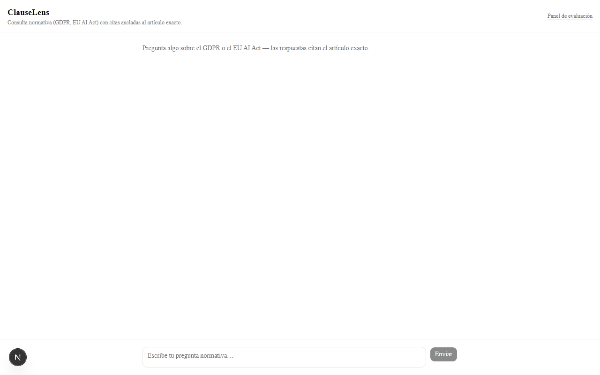
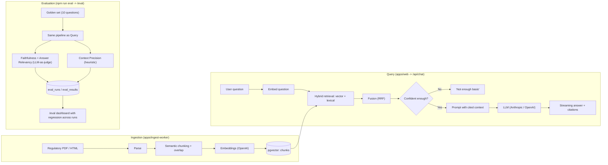

# ClauseLens

> **Hiring manager / technical reviewer?** Start with the [2-minute technical overview](REVIEWER_GUIDE.md) for evidence, code pointers and limitations.

> A production-grade regulatory RAG assistant. Ask a natural-language question about a
> regulatory corpus (GDPR, EU AI Act) and get an answer anchored to the exact clauses that
> support it — with an evaluation dashboard that proves, with metrics, that it doesn't hallucinate.



**Demo:** deployment pending (Vercel + Neon + Railway). In the meantime, the
[quickstart](#quickstart) below gets it running locally in 5 commands.

## The problem

Most RAG demos get two things wrong: they cite imprecisely (or don't cite at all), and they
have no evaluation discipline — "it works when I try it" is not a guarantee. In a regulatory
domain that's especially bad: an answer that sounds convincing but isn't anchored to the exact
article, or that invents a clause that doesn't exist, is worse than no answer at all.

ClauseLens is built so that both of these are verifiable, not just claimed:

- **Every claim cites its source fragment** (document, article, page), and the citation is
  clickable — it opens the exact fragment, not just "trust me".
- **If retrieval doesn't find enough basis, the system says so explicitly** instead of filling
  the gap with a plausible but made-up answer.
- **Every change can be measured**: a golden set of questions with known answers (including
  questions deliberately outside the corpus) runs against the real pipeline and computes
  faithfulness, answer relevancy and context precision — with results saved and comparable
  across runs, not just printed in whoever ran it's terminal.

## Architecture



Key decisions (why hybrid instead of vector-only, why RRF, why the 0.35 threshold, why these
three metrics, what was left out of scope) are documented with their reasoning in
**[DECISIONS.md](./DECISIONS.md)**.

## Stack

- **Frontend / API:** Next.js 15 (App Router), strict TypeScript, Tailwind + shadcn/ui,
  streaming via the Vercel AI SDK. Deployment target: Vercel.
- **Ingest worker:** Node + Hono. Deployment target: Railway.
- **Database:** Postgres + pgvector (target Neon), Drizzle ORM — vector search, full-text
  search and relational data all in the same database.
- **LLM:** swappable provider layer (Anthropic / OpenAI via environment variable). Embeddings
  are fixed to OpenAI (`text-embedding-3-large`, 3072 dim) — Anthropic doesn't offer an
  embeddings API.

## Quickstart

```bash
cp .env.example .env                          # fill in ANTHROPIC_API_KEY and/or OPENAI_API_KEY
npm install
npm run docker:up && npm run db:migrate        # local Postgres+pgvector, schema applied
npm run db:seed                                # ingests the seed corpus (GDPR + EU AI Act)
npm run dev:web                                # http://localhost:3000
```

In another terminal, for the ingest worker (`GET /healthz`, `POST /api/ingest`):
`npm run dev:worker` — exposes `http://localhost:8787`.

To run the evaluation harness once the corpus is seeded: `npm run eval`, results visible at
`http://localhost:3000/eval`.

## Monorepo structure

```
apps/
  web/             Next.js — chat frontend, /api/chat (streaming), /api/documents, /eval
  ingest-worker/   Hono — ingestion pipeline; seed and eval scripts
    corpus/        Seed corpus: GDPR (HTML) and EU AI Act (PDF), real EUR-Lex excerpts
packages/
  db/              Drizzle schema (documents, chunks, conversations, messages, eval_runs,
                   eval_results) + Postgres client, shared by the other packages
  core/            Hybrid retrieval (RRF), confidence threshold, swappable LLM provider,
                   prompt construction, eval harness — shared by web and ingest-worker
docker-compose.yml Postgres + pgvector for local development
```

## Monorepo scripts

| Script | What it does |
| --- | --- |
| `npm run build` | builds `db` → `core` → `ingest-worker` → `web`, in that order |
| `npm run typecheck` | `tsc --noEmit` in every workspace |
| `npm run lint` | ESLint (typescript-eslint `strictTypeChecked`) in every workspace |
| `npm run test` | unit + integration tests (Vitest) |
| `npm run db:generate` | generates a Drizzle migration from `packages/db/src/schema.ts` |
| `npm run db:migrate` | applies pending migrations |
| `npm run db:studio` | opens Drizzle Studio |
| `npm run db:seed` | parses, chunks, embeds and inserts the seed corpus |
| `npm run eval` | runs the full golden set, saves scores to `eval_runs`/`eval_results` |

## Tests

- **Unit (pure, no network or DB):** chunking (including the hard token cut when a sentence
  exceeds the limit), RRF fusion, confidence threshold, `context precision`, cost estimation,
  prompt construction.
- **Smoke tests against real data, no logic mocks:** the HTML/PDF parser and the chunker are
  exercised against the real corpus downloaded from EUR-Lex (not synthetic fixtures), only with
  a fake `Embedder` so as not to depend on an API key in CI.
- **Integration against real Postgres (no mocks):** `hybridSearch` runs against a real Postgres
  (a service container in CI) with pgvector and the full-text index — no test mocks the database.

CI (`.github/workflows/ci.yml`) runs typecheck, lint, migration against a real Postgres, tests
and build on every push.

## Status and known limitations

All six build milestones are complete (scaffolding → ingestion → retrieval/chat → frontend →
eval → this README). What's honestly still pending:

- **Not deployed**: there's no instance running on Vercel/Neon/Railway yet — the quickstart
  above is how to see it working today.
- **Not verified end to end with real credentials on this development machine**: the machine
  this project was built on has a native Postgres (not Docker) occupying port 5432 with
  credentials different from `docker-compose.yml`, and no Anthropic/OpenAI keys configured. All
  retrieval, chat and eval code is tested with real data right up to the boundary of "actually
  calling Postgres/the LLM" (parsing, chunking, rank fusion, confidence threshold, prompt
  construction — all against the real corpus); what couldn't be confirmed here is running it
  against a real database and real API keys. The retrieval integration test and the ingestion
  pipeline do run against real Postgres in CI.
- **The eval harness's judge uses the same model that generates the answers** (see
  DECISIONS.md) — a known, deliberate limitation, not an oversight.
